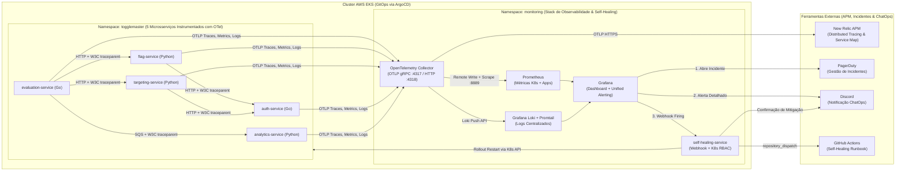

# ToggleMaster V4 - Observabilidade Total, OpenTelemetry, APM & Self-Healing

Este repositório contém a implementação completa da **Fase 4 (Tech Challenge)** do projeto **ToggleMaster**, evolucionando a arquitetura automatizada das Fases 1, 2 e 3 (5 microsserviços conteinerizados, IaC com Terraform na AWS, pipelines de CI/CD DevSecOps no GitHub Actions e GitOps com ArgoCD no EKS) com uma stack corporativa de **Observabilidade Total (Métricas, Logs e Traces padronizados via OpenTelemetry)** e **Resposta Ativa a Incidentes com Self-Healing Automático**.

---

## Arquitetura da Fase 4 (Observabilidade & Resposta Ativa)



---

## Requisitos Técnicos Implementados

### 1. Monitoramento Opensource (Métricas e Logs no K8s via GitOps)
Provisionado automaticamente no namespace `monitoring` pelo **ArgoCD** ([`gitops/argocd/applications.yaml`](gitops/argocd/applications.yaml)):
* **Prometheus (`kube-prometheus-stack`):** Coleta métricas de infraestrutura do cluster EKS (`node-exporter`, `kube-state-metrics`, `cAdvisor`) e recebe as métricas de aplicação do **OTel Collector** via *Prometheus Remote Write* e `ServiceMonitor`.
* **Grafana Loki + Promtail (`loki-stack`):** Centraliza e indexa todos os logs dos contêineres do cluster Kubernetes e recebe os logs estruturados em JSON (enriquecidos com `trace_id` e `span_id`) exportados pelo **OTel Collector**.
* **Grafana + Dashboard Customizado:** Provisionado automaticamente via ConfigMap ([`gitops/observability/grafana-dashboard.yaml`](gitops/observability/grafana-dashboard.yaml) e [`gitops/observability/dashboards/togglemaster-dashboard.json`](gitops/observability/dashboards/togglemaster-dashboard.json)) contendo:
  1. **Saúde do Cluster:** Uso de CPU e Memória por Pod no namespace `togglemaster` e disponibilidade (`Pods Ready`) dos 5 microsserviços.
  2. **Golden Signals das Aplicações:** Taxa de requisições HTTP por microsserviço (RPS), Taxa de erros HTTP 5xx (%) com linha de limiar em 5%, e Latência média das requisições (ms).
  3. **Logs em Tempo Real:** Painel de logs de incidentes/erros/Self-Healing e painel de logs correlacionados com `trace_id` de todos os microsserviços.

### 2. OpenTelemetry (OTel) e Padronização
* **OTel Collector Central ([`gitops/observability/otel-collector.yaml`](gitops/observability/otel-collector.yaml)):**
  * **Receivers:** `otlp` (gRPC na porta `4317` e HTTP na porta `4318`) e `prometheus`.
  * **Processors:** `memory_limiter`, `resource` (`service.namespace=togglemaster`, `deployment.environment=production`) e `batch`.
  * **Exporters:**
    * **Métricas -> Prometheus:** `prometheusremotewrite` e endpoint `:8889/metrics`.
    * **Logs -> Loki:** `loki` exporter enviando para `http://loki.monitoring.svc.cluster.local:3100/loki/api/v1/push`.
    * **Traces, Métricas e Logs -> New Relic APM:** `otlphttp/newrelic` enviando para `https://otlp.nr-data.net:4318`.

### 3. Instrumentação de Código e APM (New Relic)
Todos os 5 microsserviços foram instrumentados nativamente com o SDK do **OpenTelemetry** e propagação de contexto W3C (`traceparent`):
* **`auth-service` (Go):** [`services/auth-service/telemetry.go`](services/auth-service/telemetry.go) — Instrumentação OTLP HTTP de traces e métricas (`http_requests_total`, `http_request_duration_seconds`), spans de cliente PostgreSQL (`postgresql.select.api_keys`, `postgresql.insert.api_keys`) e logs JSON com `trace_id`/`span_id`.
* **`evaluation-service` (Go):** [`services/evaluation-service/telemetry.go`](services/evaluation-service/telemetry.go), [`evaluator.go`](services/evaluation-service/evaluator.go) e [`sqs.go`](services/evaluation-service/sqs.go) — Spans para Redis (`redis.get`, `redis.set`), propagação concorrente do header W3C `traceparent` nas chamadas HTTP para `flag-service` e `targeting-service`, e injeção do `traceparent` nas mensagens publicadas na fila **AWS SQS** (`sqs.send_message`).
* **`flag-service` (Python/Flask):** [`services/flag-service/telemetry.py`](services/flag-service/telemetry.py) — Auto-instrumentação de `Flask`, `requests` (propagando trace para o `auth-service`), `psycopg2` (PostgreSQL) e `logging` via OTLP.
* **`targeting-service` (Python/Flask):** [`services/targeting-service/telemetry.py`](services/targeting-service/telemetry.py) — Auto-instrumentação de `Flask`, `requests` (propagando trace para o `auth-service`), `psycopg2` (PostgreSQL) e `logging` via OTLP.
* **`analytics-service` (Python/SQS/DynamoDB):** [`services/analytics-service/telemetry.py`](services/analytics-service/telemetry.py) e [`app.py`](services/analytics-service/app.py) — Extrai o `traceparent` da mensagem SQS enviada pelo `evaluation-service` e continua o **mesmo Trace Distribuído** até a gravação no **Amazon DynamoDB** (`sqs.process_message` -> `dynamodb.put_item`), permitindo visualizar os **5 microsserviços conectados no Service Map do New Relic**!

### 4. Alertas Inteligentes, PagerDuty, Discord e Self-Healing
* **Criação do Alerta ([`gitops/observability/grafana-alerting.yaml`](gitops/observability/grafana-alerting.yaml)):**
  * Regra `AuthServiceHigh5xxErrorRate` (e `EvaluationServiceHigh5xxErrorRate`): dispara (`Firing`) quando a taxa de erros HTTP 5xx ultrapassa **5%**.
* **Gerenciamento de Incidentes (PagerDuty):** Contact Point integrado via Events API v2 (`integrationKey`) que abre incidente crítico automaticamente no PagerDuty.
* **Notificação ChatOps (Discord):** Contact Point integrado via Webhook do Discord enviando card detalhado do incidente e da mitigação automática.
* **Self-Healing Automático (Dupla Camada):**
  1. **In-Cluster Webhook Service ([`gitops/observability/self-healing.yaml`](gitops/observability/self-healing.yaml) e [`services/self-healing-service/app.py`](services/self-healing-service/app.py)):** Microsserviço com `ServiceAccount` e `Role`/`RoleBinding` no Kubernetes que recebe o alerta do Grafana e executa imediatamente o equivalente a `kubectl rollout restart deployment/auth-service -n togglemaster` via API do Kubernetes, além de enviar confirmação no Discord.
  2. **GitHub Actions Runbook ([`.github/workflows/self-healing.yml`](.github/workflows/self-healing.yml)):** Workflow disparado via `repository_dispatch` (ou `workflow_dispatch`) que autentica no EKS e executa `kubectl rollout restart deployment/<service> -n togglemaster`.

---

## Como Executar e Demonstrar na Prática (Roteiro para o Vídeo)

### Passo 1: Provisionar Infraestrutura e GitOps (ArgoCD)
```bash
# 1. Instalar/Atualizar ArgoCD e todas as Applications (5 apps + Prometheus + Grafana + Loki + OTel + Self-Healing)
./gitops/argocd/install.sh

# 2. Configurar as chaves do New Relic, PagerDuty e Discord no cluster
export NEW_RELIC_LICENSE_KEY="sua_chave_ingest_nral"
export PAGERDUTY_INTEGRATION_KEY="sua_integration_key_pagerduty"
export DISCORD_WEBHOOK_URL="https://discord.com/api/webhooks/..."
./helpers/configure-observability-secrets.sh
```

### Passo 2: Gerar Tráfego e Visualizar Grafana, Loki e New Relic (Traces & Service Map)
```bash
# Gera avaliações de flags com ?nocache=true exercitando os 5 microsserviços de ponta a ponta
./helpers/generate-traffic.sh 30

# Abrir o Grafana em http://localhost:3000 (usuário: admin / senha: admin)
kubectl port-forward svc/kube-prometheus-stack-grafana -n monitoring 3000:80
```

### Passo 3: Simular Incidente e Prova Real de Self-Healing
```bash
# Em um terminal secundário, observe os pods e o log do Self-Healing:
kubectl get pods -n togglemaster -l app=auth-service -w
kubectl logs -n monitoring -l app=self-healing-service -f

# No terminal principal, execute o simulador de incidente (injeta HTTP 500 no auth-service):
./helpers/simulate-incident.sh auth-service
```
O script ativa o modo de falha em memória (`POST /chaos?enable=true`) no `auth-service`, elevando a taxa de erros HTTP 5xx acima de 5%. O alerta dispara no Grafana, abre o incidente no **PagerDuty**, notifica o **Discord** e aciona o **Self-Healing**, que executa o `rollout restart` do `deployment/auth-service`. O novo pod sobe saudável (sem o estado de falha em memória) e a taxa de erros volta a 0% sem intervenção humana!
