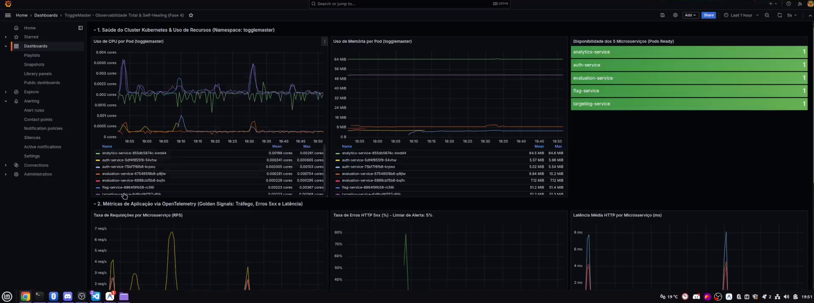
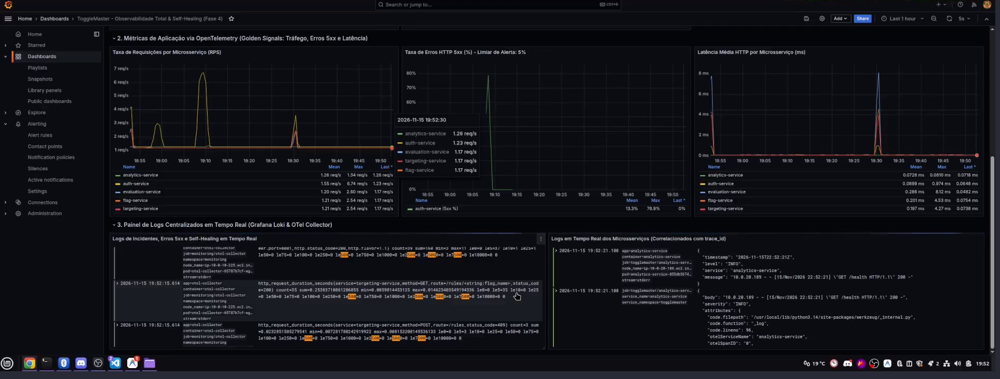
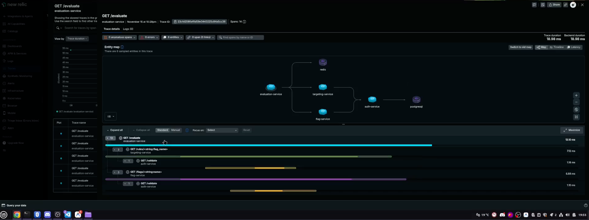
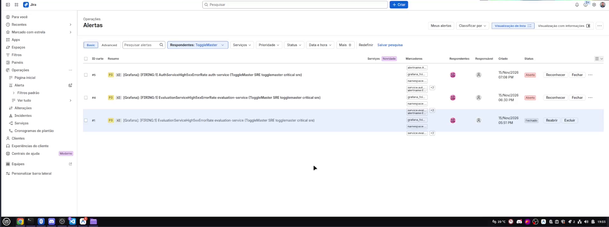
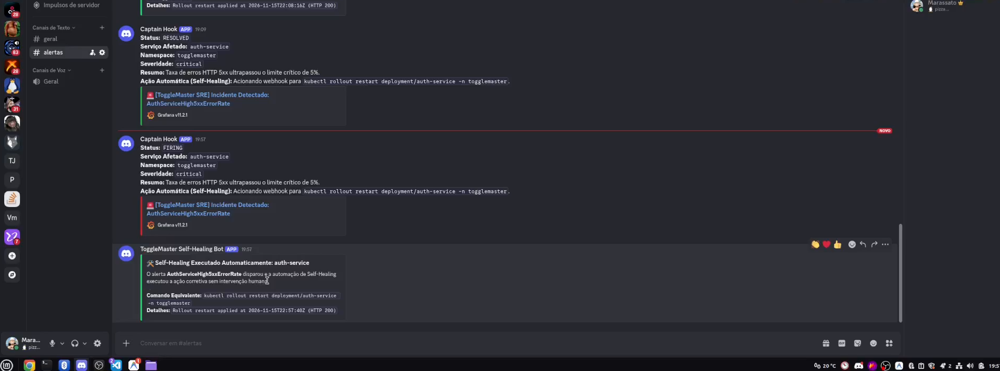
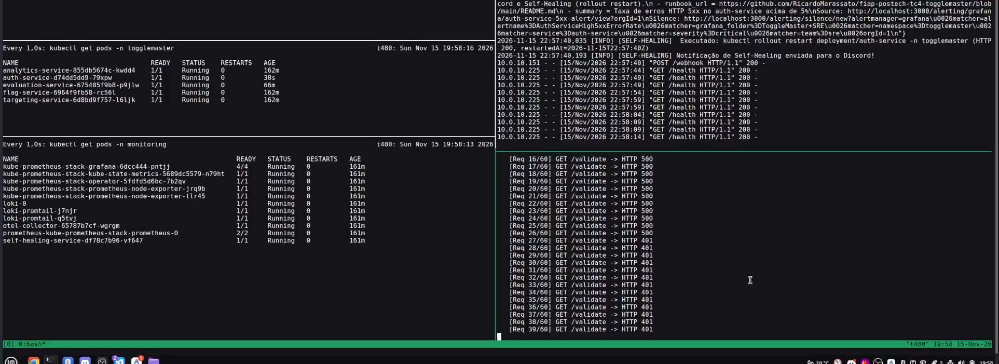

# ToggleMaster V4 - Entrega da Fase 4 (Observabilidade, OpenTelemetry, APM & Self-Healing)

Este projeto fecha a evolução do ToggleMaster (iniciada nas Fases 1, 2 e 3) adicionando uma camada completa de **Observabilidade (Métricas, Logs e Traces distribuídos com OpenTelemetry)** e **Resposta Ativa a Incidentes com Self-Healing Automático** em cima do cluster AWS EKS gerenciado via GitOps (ArgoCD).

---

## 1. Informações da Entrega

* **Aluno:** Ricardo Marassato Campos
* **RM:** 370358
* **Username Discord:** `marassato7700`
* **Repositório GitHub:** [https://github.com/RicardoMarassato/fiap-postech-tc4-togglemaster](https://github.com/RicardoMarassato/fiap-postech-tc4-togglemaster)
* **Link do Vídeo de Demonstração:** [https://drive.google.com/file/d/1WqGB6CuTSa4Txdk085_Xmvo4GIFsP2ja/view?usp=sharing](https://drive.google.com/file/d/1WqGB6CuTSa4Txdk085_Xmvo4GIFsP2ja/view?usp=sharing)

---

## 2. Justificativa Técnica da Arquitetura

### 2.1. Arquitetura do OpenTelemetry (OTel Collector)
Em vez de instalar agentes proprietários ou acoplar SDKs de fornecedores específicos dentro do código dos microsserviços, subi o **OpenTelemetry Collector (`otel/opentelemetry-collector-contrib`)** no namespace `monitoring` funcionando como um gateway central de telemetria:

1. **Instrumentação padronizada via OTLP:**
   Os 5 microsserviços (`auth-service` e `evaluation-service` em Go; `flag-service`, `targeting-service` e `analytics-service` em Python) usam apenas o SDK oficial do OpenTelemetry e enviam **Traces, Métricas e Logs** via **OTLP/HTTP** para o endereço interno do collector (`http://otel-collector.monitoring.svc.cluster.local:4318`). Se amanhã eu quiser trocar o New Relic pelo Datadog ou Grafana Tempo, não preciso mexer em nenhuma linha de código das aplicações — basta alterar o exporter no YAML do Collector.
2. **Propagação de Contexto Fim a Fim (`traceparent` no HTTP e no SQS):**
   Quando o `evaluation-service` recebe um `GET /evaluate`, ele repassa o header W3C `traceparent` nas chamadas HTTP para o `flag-service` e o `targeting-service` (que por sua vez repassam ao validar o token no `auth-service`). Como a gravação de analytics é assíncrona, injetei o `traceparent` também dentro do payload e nos `MessageAttributes` da mensagem enviada para o **Amazon SQS** (`services/evaluation-service/sqs.go`). Assim, quando o worker do `analytics-service` consome a fila e grava no **DynamoDB**, ele extrai esse contexto e pendura o span no mesmo Trace Distribuído.
3. **Pipelines do OTel Collector:**
   * **Processors (`memory_limiter`, `resource`, `batch`):** O `memory_limiter` evita que picos de telemetria derrubem o pod por OOM; o `resource` adiciona labels padronizadas (`service.namespace=togglemaster`, `deployment.environment=production`) e o `batch` agrupa os envios para reduzir chamadas de rede.
   * **Métricas -> Prometheus:** Exportadas via `prometheusremotewrite` e também expostas na porta `:8889` do collector para scrape do Prometheus.
   * **Logs -> Grafana Loki:** Os logs saem das aplicações já estruturados em JSON com `trace_id` e `span_id`, passando pelo collector até o Loki (em conjunto com o Promtail coletando stdout/stderr dos containers do cluster).
   * **Traces, Métricas e Logs -> New Relic:** Enviados pelo exporter padrão `otlphttp/newrelic` direto para o endpoint OTLP nativo do New Relic (`https://otlp.nr-data.net:4318`).

---

### 2.2. Escolha do APM: New Relic vs Datadog
Escolhi o **New Relic** para a parte de APM e Distributed Tracing por três motivos práticos:

* **Ingestão OTLP nativa sem agente próprio:** O New Relic aceita OTLP puro direto no endpoint `otlp.nr-data.net:4318` autenticando apenas com uma `License Key` no header `api-key`. Não precisei instalar DaemonSets pesados do fornecedor nos nós do EKS.
* **Montagem automática do Service Map:** Usando os atributos semânticos padrão do OpenTelemetry (`service.name`, `peer.service`, `db.system`, `messaging.system`), o New Relic já desenhou sozinho o mapa de dependências ligando os 5 microsserviços, PostgreSQL, Redis e SQS.
* **Free Tier sem burocracia:** Os 100 GB/mês gratuitos liberam o Distributed Tracing e o Entity Map completos na hora, sem exigir cartão de crédito nem aprovação de conta estudantil (diferente do trial curto de 14 dias do Datadog).

---

### 2.3. Escolha do Gerenciamento de Incidentes: OpsGenie (Jira Service Management) vs PagerDuty
A ideia inicial era usar o PagerDuty, mas acabei adotando o **OpsGenie (integrado ao Atlassian Jira Service Management)** junto com o **Discord (ChatOps)**:

* **Restrição de cadastro no PagerDuty:** O PagerDuty bloqueia a criação de contas de teste com e-mails pessoais (mesmo tentando alias `@googlemail.com`, a conta caía em `Account Is Unavailable` segundos após o cadastro). Já a Atlassian permitiu criar o ambiente gratuito normalmente.
* **Transição do OpsGenie para o Jira Service Management (JSM):** Como a Atlassian unificou os novos cadastros do OpsGenie dentro do JSM, configurei a integração nativa do Grafana dentro do painel de Operações do JSM. Por baixo dos panos, ele continua usando a mesma API v2 do OpsGenie (`api.opsgenie.com`), recebendo o payload do Grafana, deduplicando alertas repetidos pelo `alias` e fechando o incidente automaticamente (`autoClose: true`) quando o serviço volta ao normal.
* **Visibilidade imediata no Discord:** Em paralelo ao incidente formal no OpsGenie/JSM, configurei um webhook no canal `#alertas` do Discord que recebe tanto o disparo do Grafana (`FIRING` / `RESOLVED`) quanto a confirmação do bot de Self-Healing.

---

### 2.4. Estratégia de Self-Healing Automático
Para não depender de intervenção manual quando a taxa de erros HTTP 5xx passa de 5% (alerta `AuthServiceHigh5xxErrorRate`), montei a resposta automática em duas pontas:

1. **Serviço In-Cluster (`self-healing-service`):** Subi um container leve no namespace `monitoring` com uma `ServiceAccount` e `RoleBinding` restrita (permissão apenas para dar `patch` em `deployments` do namespace `togglemaster`). Quando o Grafana dispara o alerta para o webhook dele, o serviço atualiza a anotação `kubectl.kubernetes.io/restartedAt` no deployment afetado (equivalente ao `kubectl rollout restart`), forçando o Kubernetes a subir um pod limpo e matar o pod problemático. Também coloquei uma trava de *cooldown* para evitar loop de restarts caso o alerta continue ativo por alguns segundos.
2. **Workflow no GitHub Actions (`self-healing.yml`):** Deixei configurado também um workflow via `repository_dispatch` para cenários onde a remediação precise rodar de fora do cluster como um runbook de auditoria.

---

## 3. Desafios Enfrentados e Soluções

Durante a montagem e gravação desta Fase 4, esbarrei em vários problemas reais de infraestrutura e integração que precisei contornar:

### 1. Limite de Pods no EKS e Estouro de Memória nas `t3.small`
* **Desafio:** Na Fase 3, 2 instâncias `t3.small` (2 vCPUs e 2 GiB de RAM cada) davam conta dos microsserviços e do ArgoCD. Porém, ao subir a stack inteira de observabilidade na Fase 4 (Prometheus, Grafana, Loki, Promtail, OTel Collector e Self-Healing), o total passou de 25 pods. Como a `t3.small` suporta no máximo 11 pods por nó na configuração padrão da VPC CNI (total de 22 pods em 2 nós) e tem pouca memória, vários pods ficaram presos em `Pending`. Para piorar, minha conta AWS tinha limite de quota de 4 vCPUs para instâncias On-Demand, então eu não podia simplesmente adicionar um terceiro nó.
* **Solução:** Troquei os worker nodes no Terraform para 2 instâncias **`m7i-flex.large`** (que também têm 2 vCPUs cada, respeitando o limite de 4 vCPUs da conta, mas entregam **8 GiB de RAM** por nó e entram no Free Tier), ativei `ENABLE_PREFIX_DELEGATION = "true"` no addon `vpc-cni` (aumentando o limite para 29 pods por nó) e enxuguei pods desnecessários desativando o `alertmanager` do Prometheus (já que uso o Unified Alerting do Grafana) e escalando para 0 réplicas três controllers opcionais do ArgoCD (`dex-server`, `notifications-controller` e `applicationset-controller`).

### 2. Falha de Permissão no SQS/DynamoDB por conta do `IMDSv2 hop-limit = 1`
* **Desafio:** Depois de migrar para as instâncias `m7i-flex.large`, percebi no New Relic que o `analytics-service` estava dando 100% de erro nas chamadas `SQS.ReceiveMessage` por falta de credenciais da AWS, mesmo com a IAM Role anexada corretamente no Node Group. Isso aconteceu porque as instâncias de geração mais nova da AWS vêm por padrão com o **IMDSv2** exigindo `http-put-response-hop-limit = 1`. Como o pod roda dentro de um container (um salto de rede a mais que a EC2), o pacote de resposta do serviço de metadados (`169.254.169.254`) morria no caminho com TTL expirado.
* **Solução:** Ajustei o limite de saltos do IMDSv2 nos worker nodes para `2` (`aws ec2 modify-instance-metadata-options --http-put-response-hop-limit 2`) e adicionei essa garantia direto no script de automação. Na mesma hora os pods voltaram a autenticar no SQS e no DynamoDB.

### 3. Bloqueio no PagerDuty e Descontinuação do OpsGenie Standalone
* **Desafio:** Perdi um bom tempo tentando criar conta no PagerDuty, porque o formulário aceitava meu Gmail (e até o truque do `@googlemail.com`), mas logo após o login redirecionava para uma tela de `Account Is Unavailable` exigindo domínio corporativo. Quando decidi mudar para o OpsGenie, descobri que a Atlassian encerrou o cadastro de contas standalone do OpsGenie em junho de 2025.
* **Solução:** Criei um workspace gratuito no **Jira Service Management (JSM)**, que agora incorpora toda a parte de *Alerting* e *On-Call* do OpsGenie. Configurei a integração de API do Grafana lá dentro, peguei a `API Key` gerada e troquei o Contact Point do Grafana de PagerDuty para OpsGenie.

### 4. State Lock Preso no S3 após Queda de Energia do Notebook
* **Desafio:** Enquanto eu rodava um `terraform destroy` em um dos dias de teste, a bateria externa do meu ThinkPad T480 travou e o notebook desligou no meio da execução. Quando liguei de volta e tentei rodar `terraform plan`, o Terraform bloqueou a execução acusando `Error acquiring the state lock (StatusCode: 412 PreconditionFailed)` porque o arquivo `.tflock` ficou órfão lá no bucket S3.
* **Solução:** Destravei o estado remotamente rodando `terraform force-unlock -force <LOCK_ID>` e em seguida executei o `terraform apply` para reconciliar os recursos que tinham ficado pela metade na AWS.

### 5. Excesso de Traces de `/health` no New Relic
* **Desafio:** Ao abrir a aba de Traces do New Relic pela primeira vez, só apareciam grupos de `GET /health`. Como as probes do Kubernetes batem nos 5 microsserviços a cada 5 segundos, o volume de traces de 1 único span engolia a visualização das requisições reais de negócio (`GET /evaluate`).
* **Solução:** Usei o filtro `Multi-span only` no New Relic para isolar apenas traces distribuídos reais que atravessam múltiplos serviços e ajustei o script `generate-traffic.sh` para reiniciar o deployment do `evaluation-service` sempre que uma nova API Key de teste fosse recriada no banco, garantindo tráfego 200 OK passando pelos 5 serviços, Redis, Postgres e SQS.

---

## 4. Evidências Visuais Obrigatórias

> *Capturas extraídas do vídeo de demonstração.*

### 4.1. Print do Dashboard Customizado do Grafana
Dashboard `ToggleMaster - Observabilidade Total & Self-Healing (Fase 4)`: saúde do cluster (CPU, memória e pods Ready por microsserviço), Golden Signals (RPS, taxa de erros HTTP 5xx e latência) e logs centralizados do Loki com `trace_id`.

### 4.2. Print de um Trace Distribuído e Service Map no New Relic (APM)
Trace da requisição `GET /evaluate`: o Entity Map mostra `evaluation-service` → `flag-service` / `targeting-service` / `redis` → `auth-service` → `postgresql`, e a cascata de spans abaixo.

### 4.3. Print do Incidente no OpsGenie (Jira Service Management) e Notificação no ChatOps (Discord)
Alertas `[FIRING]` criados automaticamente pelo Grafana no OpsGenie/JSM, e as notificações no canal `#alertas` do Discord (alerta `FIRING`, confirmação do Self-Healing Bot e `RESOLVED`).

### 4.4. Print do Log e Execução da Automação de Self-Healing
Log do `self-healing-service` recebendo o webhook `[FIRING:1] AuthServiceHigh5xxErrorRate` e executando `kubectl rollout restart deployment/auth-service -n togglemaster` (HTTP 200). O pod novo do `auth-service` aparece com 38s de idade, e as requisições mudam de `HTTP 500` para `HTTP 401` (pod novo sem a falha injetada).

---

## 5. Próximos Passos (Melhorias Futuras)

Para evoluir essa arquitetura de observabilidade em um cenário real de produção:
* **Filtro de `/health` no Processor do OTel Collector:** Adicionar o processor `filter` no `otel-collector.yaml` para descartar spans de rotas `/health` e `/metrics` antes de enviar para o New Relic, economizando franquia de ingestão de dados.
* **Tail-Based Sampling:** Configurar amostragem baseada em cauda (*tail sampling*) no Collector para manter 100% dos traces que derem erro (HTTP 5xx ou alta latência) e amostrar apenas uma porcentagem (ex: 10%) dos traces 200 OK em alto volume.
* **Correlação Exemplars no Prometheus/Grafana:** Habilitar *Exemplars* nas métricas de histograma de latência para permitir clicar direto em um ponto de pico do gráfico no Grafana e abrir o `trace_id` correspondente.
